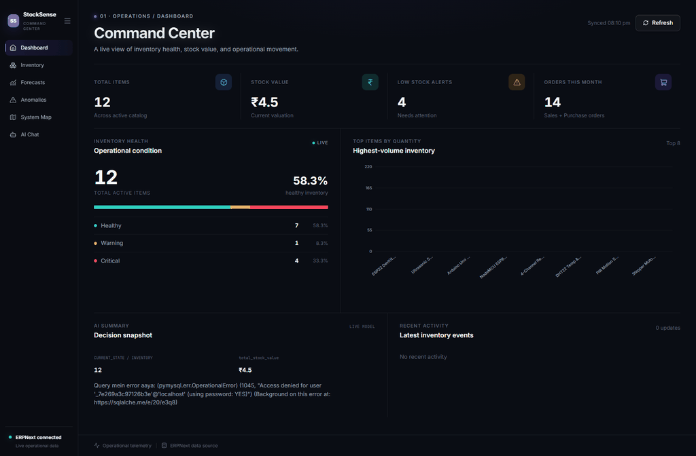
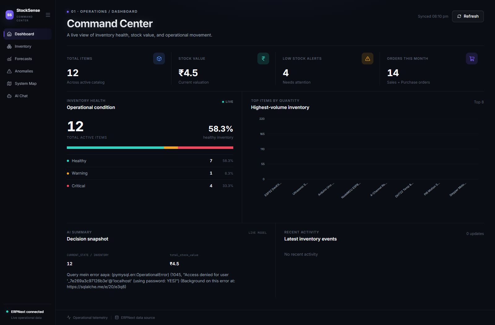
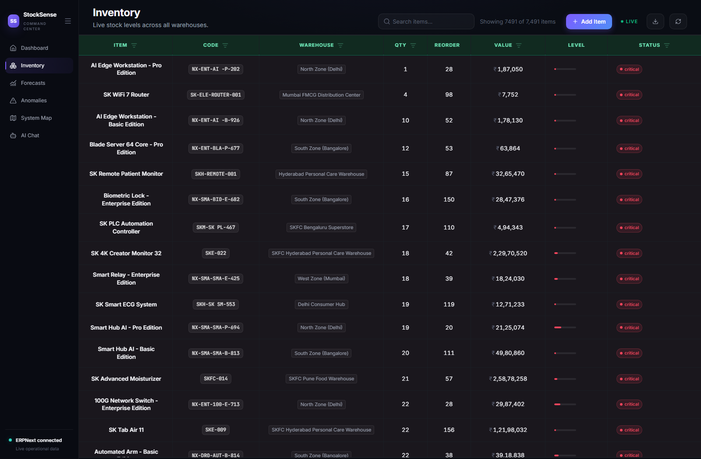
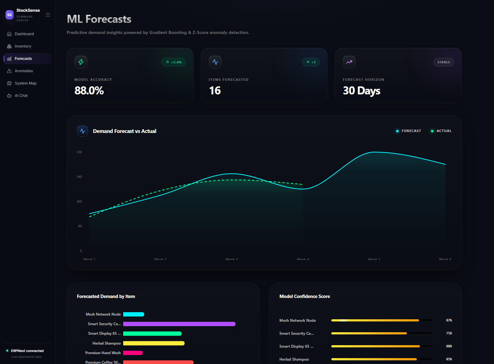
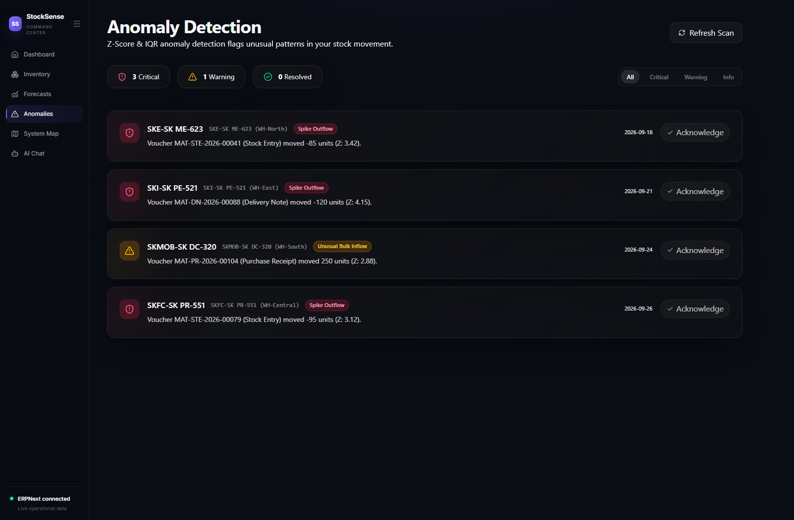
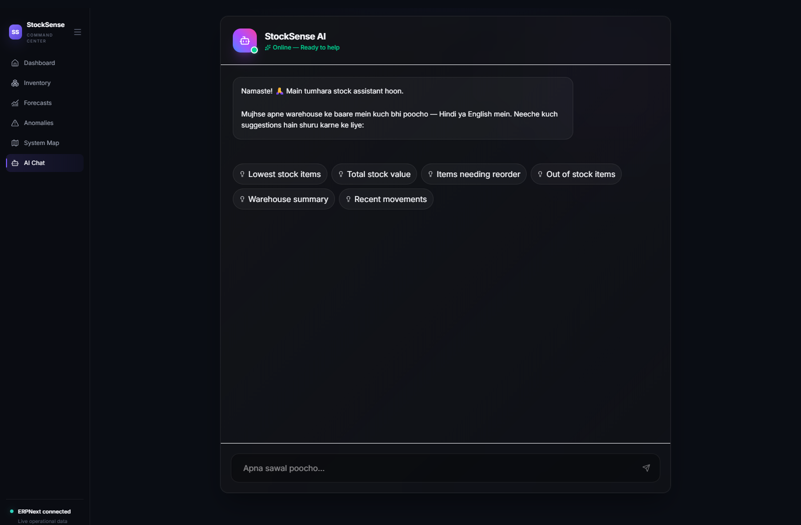
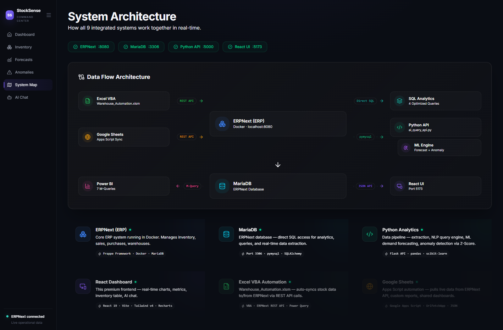
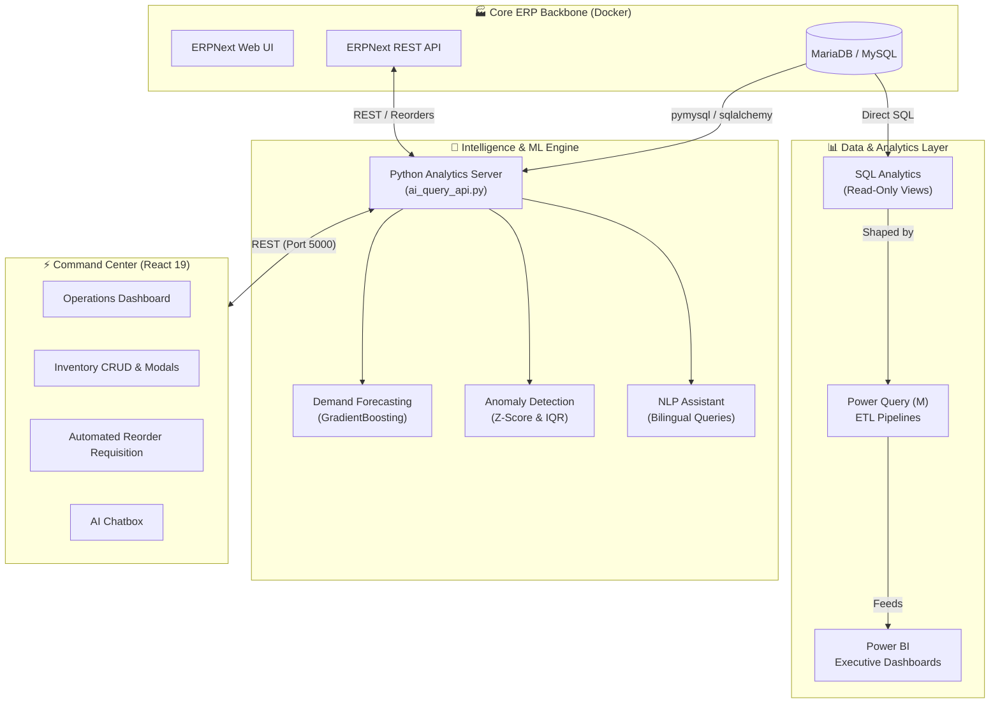

<div align="center">
  <h1>📦 StockSense</h1>
  <p><strong>Warehouse Operations Analytics & Intelligence Platform</strong></p>
  <p>From raw ERP data to AI-driven decisions — one platform, one source of truth.<br />
  Built on ERPNext · Powered by React 19 · Forecasting with Scikit-Learn · Reported through Power BI</p>

  <p>
    <a href="https://github.com/Satya522/stocksense/actions/workflows/ci.yml"></a>
    
    
    
    
    
    
  </p>

  <p>
    <a href="#-why-stocksense">Why StockSense?</a> ·
    <a href="#-features">Features</a> ·
    <a href="#-live-demo">Live Demo</a> ·
    <a href="#-architecture">Architecture</a> ·
    <a href="#-tech-stack">Tech Stack</a> ·
    <a href="#-quickstart">Quickstart</a> ·
    <a href="#-api-reference">API Reference</a> ·
    <a href="#-roadmap">Roadmap</a>
  </p>

  <br />
  <a href="docs/screenshots/stocksense_demo.gif">
    
  </a>
</div>

---

## 📑 Table of Contents
- [Why StockSense?](#-why-stocksense)
- [Features](#-features)
- [Live Demo](#-live-demo)
- [Architecture](#-architecture)
- [Tech Stack](#-tech-stack)
- [Machine Learning Engine](#-machine-learning-engine)
- [Repository Structure](#-repository-structure)
- [Quickstart](#-quickstart)
- [API Reference](#-api-reference)
- [Testing](#-testing)
- [CI/CD](#-cicd)
- [Roadmap](#-roadmap)
- [Contributing](#-contributing)
- [License](#-license)
- [Author](#-author)

---

## 🎯 Why StockSense?

Most warehouses already sit on a goldmine of data: stock ledgers, bin records, material requests. The problem is that this data lives inside the ERP, and turning it into decisions usually means exports, spreadsheets, and gut feeling.

StockSense closes that gap. It layers an intelligence and visualization stack on top of ERPNext so that operations teams can answer the questions that actually matter:

| Question | How StockSense answers it |
| :--- | :--- |
| **What is about to run out?** | Live stock-health telemetry with healthy / warning / critical states |
| **How much will we need next week?** | Gradient Boosting demand forecasting on stock-ledger velocity |
| **Is something wrong with our stock movement?** | Z-Score and IQR anomaly detection on transactions |
| **Can I just ask the system?** | Bilingual (English + Hindi) natural-language assistant |
| **How do I act on it?** | One-click Material Request generation, written back to ERPNext |

> 💡 **Built by a warehouse operations professional transitioning into IT**, so every feature here solves a problem that was first experienced on the warehouse floor.

---

## ✨ Features

### ⚡ Operations Command Center
- Real-time KPI telemetry rail covering total items, quantity, valuation, and alerts
- Interactive Stock Health Ring and top-items distribution charts
- Recent transaction audit trail for instant traceability

### 📦 Inventory Management
- Table with instant multi-column filtering and low-stock threshold triggers
- Excel-style conditional filters
- Export to 10 formats: CSV, Excel, TSV, JSON, SQL, and more
- Glassmorphism modals for Add / Edit / Reorder SKU workflows
- Full CRUD lifecycle with persistence to MariaDB and a local JSON override layer

### 🧠 Intelligence Layer
- Demand forecasting with a Gradient Boosting Regressor and lag and rolling-window features
- Anomaly detection using Z-Score (> 2.5) and Interquartile Range (IQR)
- AI Stock Assistant with NLP and fuzzy keyword matching, in English and Hindi
- Automated reorder requisitions with auditable history

### 📊 Analytics & Automation
- Read-only SQL analytics views over the ERPNext database
- Power Query (M) ETL pipelines feeding Power BI executive dashboards
- Excel VBA and Google Apps Script automation for Material Requests

### 🚢 Engineering Quality
- Dockerized multi-service deployment (ERPNext, MariaDB, API, frontend)
- GitHub Actions pipeline for lint, build, syntax checks, and Pytest
- Pytest suite covering API CRUD, ML pipelines, and NLP fallbacks
- One-click Vercel deployment config for the frontend

---

## 🎬 Live Demo

An end-to-end walkthrough shows live stock movements, AI queries in Hindi and English, and instant Material Request generation. The preview GIF sits at the top of this page.

### 1 · Operations Command Center
KPI rail, valuation metrics, Stock Health Ring, top-stock distribution, and recent transaction trail.



---

### 2 · Inventory Management
Multi-column filters, low-stock triggers, 10-format export, and Add / Edit / Reorder modals.



---

### 3 · Demand Forecasting
Weekly replenishment demand predicted from historical stock-ledger velocity.



---

### 4 · Anomaly Detection
Unexpected outflows, suspicious shrinkage, and sudden receipt spikes, flagged automatically.



---

### 5 · AI Stock Assistant
Ask about stock, valuation, and reorders in plain English or Hindi.



---

### 6 · System Topology
Heartbeat latency and connection status across MariaDB, ERPNext REST, the Python engine, and the React client.



---

## 🏗 Architecture

StockSense is organized into four layers, with ERPNext as the single source of truth.



### Design principles
- **ERP as the source of truth.** Nothing replaces ERPNext. StockSense reads from it and writes back Material Requests through its API.
- **Read-only analytics.** The BI path goes through SQL views, so reporting can never corrupt transactional data.
- **Graceful degradation.** The frontend API client includes fallback handling, so the UI stays usable when a service is unreachable.
- **Everything is containerized.** One Compose file boots the whole ecosystem.

---

## 🛠 Tech Stack

| Layer | Technology | Role |
| :--- | :--- | :--- |
| **Frontend** | React 19, Vite | Reactive Command Center SPA |
| **UI** | Tailwind CSS, Lucide | Glassmorphism design system, responsive layout, icons |
| **Data Viz** | Recharts | Telemetry rings, distribution charts, forecast lines |
| **Backend** | Python 3.11 | Lightweight REST API and data pipelines |
| **ML** | Scikit-Learn, Pandas | Feature engineering, Gradient Boosting, Z-Score / IQR |
| **ERP** | ERPNext v16 / v15 | Item master, Stock Ledger Entries, Bin records, Material Requests |
| **Database** | MariaDB 11.8 / 10.11 | Transactional store behind ERPNext (ports 3307 / 3306) |
| **BI** | Power BI, Power Query | Executive dashboards and automated M-queries |
| **DevOps** | Docker, Docker Compose | Multi-container orchestration |
| **CI/CD** | GitHub Actions | Lint, build, syntax verification, Pytest |

---

## 🤖 Machine Learning Engine

### Demand Forecasting · `python/src/demand_forecast.py`
A Gradient Boosting Regressor predicts future weekly replenishment demand per item.
- **Input**: Historical stock-ledger movement
- **Features**: Lag-1 values and 3-day rolling windows
- **Output**: `avg_daily_demand_forecast` and `weekly_demand_forecast` per item
- **Precomputed results**: `data/demand_forecast_results.csv`

### Anomaly Detection · `python/src/anomaly_detection.py`
Two complementary statistical methods catch different kinds of outliers:

| Method | Rule | Catches |
| :--- | :--- | :--- |
| **Z-Score** | $\|z\| > 2.5$ | High-velocity single-event transaction spikes |
| **IQR** | Outside the interquartile fences | Skewed or non-normal distributions |

Each flagged record carries its `z_score`, `anomaly_type`, and voucher metadata for audit. Results are exported to `data/anomaly_report.csv`.

### NLP Stock Assistant · `python/src/ai_stock_query.py`
Fuzzy keyword matching and intent parsing answer stock, valuation, and reorder questions in English and Hindi:
```bash
"which item has the lowest stock?"
"sabse kam stock kisme hai?"
```

---

## 📁 Repository Structure

```
stocksense/
├── stocksense-frontend/          # React 19 + Vite Command Center
│   ├── src/pages/                # Dashboard, Inventory, Forecasts, Anomalies, SystemMap
│   ├── src/components/           # Sidebar, AIChatBox, MetricCard, StockHealthRing, StockTable
│   ├── src/lib/api.js            # REST client with fallback handling
│   ├── Dockerfile                # Multi-stage production build (Nginx Alpine)
│   ├── nginx.conf                # Production routing and gzip caching
│   └── vercel.json               # Vercel deployment rewrite rules
│
├── python/                       # Backend, ML engines, and tests
│   ├── src/ai_query_api.py       # REST API server and persistence engine
│   ├── src/demand_forecast.py    # Gradient Boosting demand forecaster
│   ├── src/anomaly_detection.py  # Z-Score and IQR anomaly detector
│   ├── src/ai_stock_query.py     # Natural-language query engine
│   ├── tests/                    # Pytest suite (API CRUD, ML, NLP)
│   ├── Dockerfile                # Python 3.11-slim API container
│   └── requirements.txt          # Python dependencies
│
├── data/                         # Baseline datasets and persistence layers
│   ├── demand_forecast_results.csv
│   ├── anomaly_report.csv
│   ├── inventory_overrides.json  # Local persistent CRUD layer
│   └── reorder_history.json      # Audit log of generated Material Requests
│
├── deployment/
│   └── docker-compose.stocksense.yml
│
├── erpnext-setup/                # ERPNext configuration and client scripts
├── sql-analytics/                # Read-only SQL views
├── power-query/m-queries/        # Power Query (M) ETL pipelines
├── powerbi-dashboards/           # Power BI executive dashboards
├── excel-automation/             # Excel VBA macros
├── sheets-automation/            # Google Apps Script automation
├── docs/                         # Roadmap, diagrams, and screenshots
└── .github/workflows/ci.yml      # CI pipeline
```

---

## 🚀 Quickstart

### Prerequisites

| Tool | Version |
| :--- | :--- |
| **Node.js** | 18+ |
| **Python** | 3.11+ |
| **Docker & Docker Compose** | Latest (for the full stack) |

### Option A · Full stack with Docker (recommended)
Boots MariaDB, ERPNext, the Python API, and the Nginx-served React frontend together.

```bash
git clone https://github.com/Satya522/stocksense.git
cd stocksense
docker compose -f deployment/docker-compose.stocksense.yml up -d
```

| Service | URL |
| :--- | :--- |
| **⚡ React Command Center** | `http://localhost:3000` |
| **🧠 Python ML API** | `http://localhost:5000` |
| **🏭 ERPNext Desk** | `http://localhost:8080` |

### Option B · Local development

#### 1. Backend (Python API + ML)
```bash
cd stocksense/python
python -m venv venv

# Windows
venv\Scripts\activate

# macOS / Linux
source venv/bin/activate

pip install -r requirements.txt
python src/ai_query_api.py
```
The API runs on `http://localhost:5000`. Override the port with the `PORT` environment variable.

#### 2. Frontend (React Command Center)
```bash
cd stocksense/stocksense-frontend
npm install
npm run dev
```
Open `http://localhost:5173`. Each view has a direct URL:

| View | URL |
| :--- | :--- |
| **Dashboard** | `/#dashboard` |
| **Inventory** | `/#inventory` |
| **Forecasts** | `/#forecasts` |
| **Anomalies** | `/#anomalies` |
| **System Map** | `/#system` |
| **AI Assistant** | `/#chat` |

---

## 🔌 API Reference

**Base URL**: `http://localhost:5000`

| Method | Endpoint | Description |
| :--- | :--- | :--- |
| `GET` | `/api/health` | Health check and NLP engine availability |
| `GET` | `/api/dashboard/stats` | Aggregated metrics: items, quantity, valuation, alerts |
| `GET` | `/api/dashboard/stock` | Full inventory telemetry with health status |
| `POST` | `/api/inventory/add` | Add a new item and bin record |
| `POST` | `/api/inventory/update` | Update stock quantity or reorder threshold |
| `POST` | `/api/inventory/delete` | Remove a SKU from active tracking |
| `POST` | `/api/reorder` | Generate a Material Request requisition |
| `GET` | `/api/forecasts` | ML demand forecast projections |
| `GET` | `/api/anomalies` | Z-Score and IQR detected outliers |
| `POST` | `/api/ask` | Natural-language Q&A (English / Hindi) |

<details>
<summary><b>📖 Example requests and responses</b></summary>
<br />

**Health check**
```bash
curl http://localhost:5000/api/health
```
```json
{ "status": "ok", "service": "StockSense AI v2", "nlp": true }
```

**Dashboard stats**
```json
{ "total_items": 427, "total_value": "₹149,035.7 Cr", "low_stock_alerts": 110 }
```

**Add inventory**
```bash
curl -X POST http://localhost:5000/api/inventory/add \
  -H "Content-Type: application/json" \
  -d '{"code":"SKU-99","name":"Sensor","warehouse":"WH-North","qty":100,"rate":250}'
```

**Update inventory**
```json
{ "code": "SKU-99", "warehouse": "WH-North", "qty": 80, "reorder": 20 }
```

**Delete inventory**
```json
{ "code": "SKU-99", "warehouse": "WH-North" }
```

**Create a reorder (Material Request)**
```json
{ "item_code": "SKU-01", "qty": 50, "priority": "Urgent", "supplier": "Apex Tech" }
```
*Request IDs follow the format `MR-YYYYMMDD-XXXX`.*

**Ask the assistant**
```bash
curl -X POST http://localhost:5000/api/ask \
  -H "Content-Type: application/json" \
  -d '{"question":"sabse kam stock kisme hai?"}'
```

</details>

---

## 🧪 Testing

```bash
cd stocksense

# Windows
.\python\venv\Scripts\pytest.exe python/tests -v

# macOS / Linux
./python/venv/bin/pytest python/tests -v
```

| Test | What it verifies |
| :--- | :--- |
| `test_get_dashboard_stats_structure` | Summary keys and numeric types |
| `test_get_stock_data_items` | Telemetry and dynamic status assignment |
| `test_inventory_crud_lifecycle` | Create → Read → Update → Status trigger → Delete → Verify removal |
| `test_create_reorder_request` | Material Request ID format and audit log persistence |
| `test_predict_demand_records` | Forecast schema and positive predictions |
| `test_create_features_pipeline` | Lag-1 and 3-day rolling-window feature math |
| `test_detect_anomalies_records` | Outlier classification and Z-score thresholding |
| `test_api_handler_fallback_answers` | NLP and conversational fallback logic |

---

## 🔄 CI/CD

Every push and pull request runs through GitHub Actions:
- Lint the frontend and backend
- Build the React application
- Verify syntax of the Python modules
- Run Pytest against the API and ML engines

The frontend ships with a multi-stage Dockerfile (Nginx Alpine) and a `vercel.json` for one-click cloud deployment.

---

## 🗺 Roadmap

| Phase | Focus | Status |
| :--- | :--- | :--- |
| **1** | ERPNext setup, MariaDB schema, SQL analytics views | ✅ Complete |
| **2** | Excel VBA macros and Google Apps Script Material Requests | ✅ Complete |
| **3** | Power Query ETL, GBR demand forecasting, anomaly engine | ✅ Complete |
| **4** | AI NLP assistant, client scripts, Docker containerization | ✅ Complete |
| **5** | React 19 Command Center, CRUD modals, Pytest suite, CI | ✅ Complete |

---

## 🤝 Contributing

Contributions, issues, and feature requests are welcome.

1. Fork the repository
2. Create a feature branch: `git checkout -b feature/your-feature`
3. Commit your changes: `git commit -m "feat: add your feature"`
4. Make sure the tests pass: `pytest python/tests -v`
5. Push the branch and open a Pull Request

Please follow [Conventional Commits](https://www.conventionalcommits.org/) for commit messages.

---

## 📄 License

Distributed under the MIT License. Built for portfolio demonstration and educational purposes.

---

## 👤 Author

**Satya** · [@Satya522](https://github.com/Satya522)

> A warehouse operations professional turned builder, using data, ML, and automation to make supply chains smarter.

<div align="center">
  <br />
  If StockSense helped or inspired you, consider giving it a ⭐
</div>
