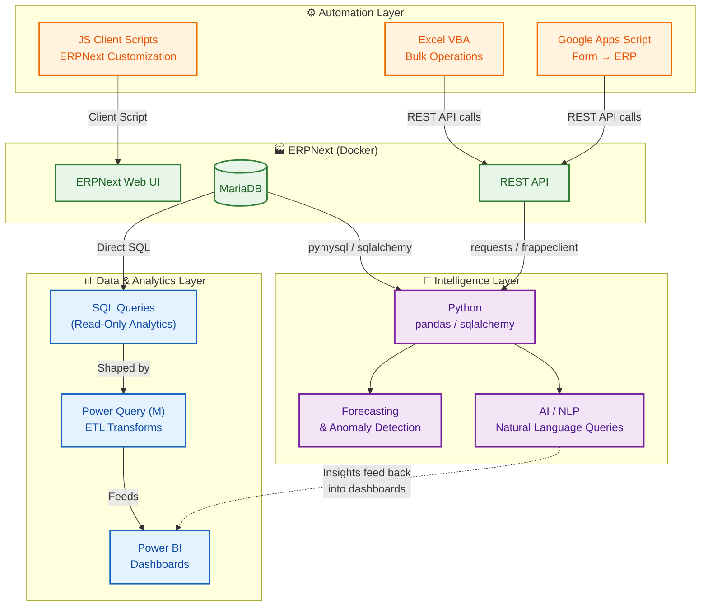

# StockSense — Architecture

## System Architecture Diagram



## Data Flow Summary

### Phase 1 — Core Analytics Pipeline (Current)
```
ERPNext MariaDB → SQL Queries → Power Query (M) → Power BI Dashboards
ERPNext REST API → Python test scripts (connection validation)
```

### Phase 2 — Automation
```
Excel VBA macros → ERPNext REST API (bulk order processing)
Google Forms → Apps Script → ERPNext REST API (Material Requests)
```

### Phase 3 — Advanced Analytics
```
MariaDB + External Sources → Power Query (multi-source ETL) → Power BI
MariaDB → Python pandas → Forecasting models → Dashboard integration
```

### Phase 4 — AI & Deployment
```
User natural language → AI layer → SQL/API → Answers
JavaScript client scripts → ERPNext UI customization
Docker Compose → Full-stack packaged deployment
```

## Key Design Principles

1. **ERPNext is the single source of truth** — all data originates from and is
   managed through ERPNext. External tools only read from or write via the API.

2. **Database queries are read-only** — we never modify ERPNext tables via direct
   SQL. All writes go through the REST API to preserve ERPNext's business logic.

3. **Layered architecture** — each layer (data, automation, intelligence) is
   independent and can be developed/deployed incrementally.

4. **Credentials are never hardcoded** — all secrets live in `.env` files that
   are excluded from version control.
